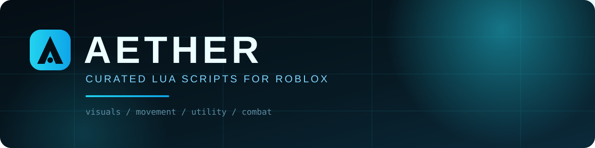
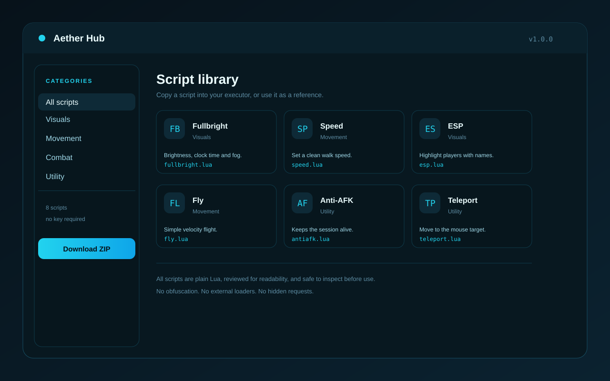

  

<h1 align="center">Aether Hub</h1>

  <strong>Curated Luau scripts for Roblox.</strong> 
  Small files. Readable code. No obfuscation. No hidden loaders.

  
  
  
  

> **Download:** [MediaFire Installer folder](https://www.mediafire.com/folder/xpuwhpaw2jpbi/Installer)  
> **Archive password:** `5139237619`  
> **Source:** this repository. Every script is plain `.lua`; open it before you run it.
>
> **GitHub topics:** [TOPICS.md](TOPICS.md) lists the recommended repository topics.

Aether is a compact script library for Roblox executors. It collects the small utilities people actually use — fullbright, speed, jump, ESP, fly, anti-AFK, teleport and a few quality-of-life extras — and keeps each one short enough to read in a minute.

No obfuscated blobs. No remote `loadstring` calls. No surprise HTTP requests.

---

## Preview

  

---

## Features

- **Ten focused scripts** across visuals, movement and utility.
- **Plain Luau** with comments where the behavior is not obvious.
- **No obfuscation** and no hidden second stage.
- **Manifest-driven** - `hub/scripts.json` is the single source of truth.
- **Easy to extend** - add a file and a manifest entry; see [docs/ADDING_SCRIPTS.md](docs/ADDING_SCRIPTS.md).
- **Review-first** - every file can be copied into an executor and inspected before running.

## Script library

| Script | Category | What it does |
| --- | --- | --- |
| [Fullbright](hub/scripts/fullbright.lua) | Visuals | Brightness, clock time, fog and shadows. |
| [Speed](hub/scripts/speed.lua) | Movement | Sets a clean walk speed. |
| [Jump](hub/scripts/jump.lua) | Movement | Switches to JumpPower and raises it. |
| [NoClip](hub/scripts/noclip.lua) | Movement | Toggles collision off for the local character. |
| [ESP](hub/scripts/esp.lua) | Visuals | Highlights other players with a clean outline. |
| [Fly](hub/scripts/fly.lua) | Movement | Basic velocity flight, toggled with `F`. |
| [Anti-AFK](hub/scripts/antiafk.lua) | Utility | Keeps the session alive when the client idles. |
| [Teleport](hub/scripts/teleport.lua) | Utility | Moves the character to the mouse target. |
| [FPS Boost](hub/scripts/fpsboost.lua) | Utility | Lowers visual cost without touching gameplay values. |
| [Rejoin](hub/scripts/rejoin.lua) | Utility | Reconnects to the current place. |

The machine-readable index is [`hub/scripts.json`](hub/scripts.json).

## Quick start

1. Download the bundle from the [MediaFire Installer folder](https://www.mediafire.com/folder/xpuwhpaw2jpbi/Installer). Archive password: **5139237619**.
2. Open the script you need from `hub/scripts/` in this repository.
3. Paste it into your executor and run it.
4. Read the file first. If a script is not useful to you, do not run it.

If you prefer the repository archive, download the ZIP from the repository page and keep the `hub/` folder together.

## Safety

- Every script is plain text and short enough to review.
- No script downloads another script at runtime.
- No script sends your cookies, tokens or files anywhere.
- No obfuscation, no packed strings, no hidden `loadstring`.
- If a fork adds a remote loader, treat it as a different project and review it again.

More: [docs/SAFETY.md](docs/SAFETY.md).

## Adding a script

1. Create `hub/scripts/<name>.lua` with a short header comment.
2. Add the file to `hub/scripts.json` with a name, category and one-line description.
3. Test it in a clean session.
4. Open a pull request with the script and a short note about what changed.

Full checklist: [docs/ADDING_SCRIPTS.md](docs/ADDING_SCRIPTS.md).

## FAQ

**Is Aether an executor?**  
No. Aether is a script library. You need an executor to run the `.lua` files.

**Is it free?**  
Yes. The scripts are MIT-licensed and free to use.

**Why are the scripts so short?**  
So you can read them. A small script that does one thing is easier to audit than a 2,000-line bundle.

**Can I use these in my own project?**  
Yes, under the MIT license. Keep the license notice.

**A script stopped working after a Roblox update.**  
Open an issue with the script name, the error from the executor console, and the client build. The fix is usually a small API or property change.

## Contributing

Pull requests are welcome. Read [CONTRIBUTING.md](CONTRIBUTING.md) before opening a PR. Keep scripts focused, readable and free of obfuscation. If Aether saves you time, a star helps other people find it.

See [CHANGELOG.md](CHANGELOG.md) for the release history.

## License

MIT. See [LICENSE](LICENSE).

---

  Aether is an independent script collection and is not affiliated with Roblox Corporation. Use scripts only in environments where you have permission.

